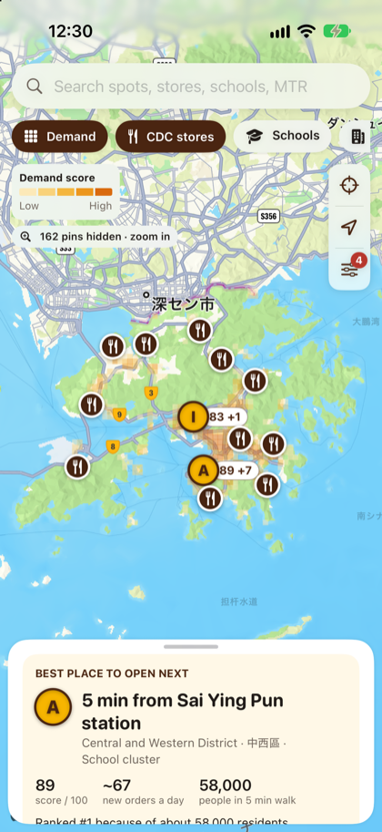
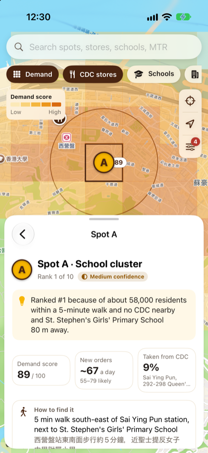
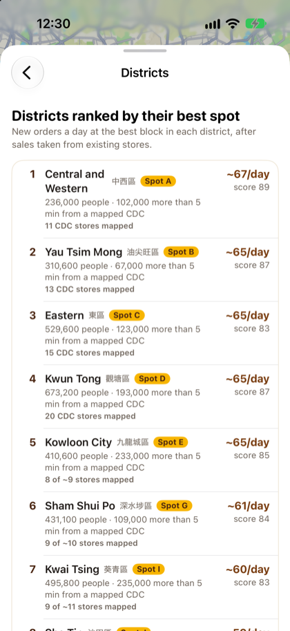

# CDC Site Finder (concept)

An iPhone app for Team 26210's "Gateway to Tomorrow" case: Solution 3, **How the AI picks the spots**, as a working map. It scores all **7,522 street blocks (about 280 m square) across Hong Kong** from six inputs. It names the best place to open next, ranks a shortlist of 10 spots spread over the city (at most two per district) and ranks all 18 districts. It explains every score, lets the team approve or skip each pick, reviews field reports before they change the map, and learns from locker pilots.

> **Student concept.** Not affiliated with Café de Coral Holdings Limited. The map data is real: homes, schools, universities, MTR stations, offices, shops and rival chains come from OpenStreetMap; district populations from the 2021 Census; and 173 CDC locations from the published branch list (May 2023), the team's 30 checked branches and OpenStreetMap. Two inputs are stand-ins: **homes with no CDC nearby** stand in for app orders, and **shop density** stands in for rent. Pilot results, the seeded reports and the "hidden truth" the pilots learn towards are simulated.

<p>
  
  
  
</p>

## What the data says (current build)

| | Place | District | Score | New orders a day | Why |
|---|---|---|---|---|---|
| **Best** | Park Road / Lyttelton Road, 5 min walk above Sai Ying Pun station | Central and Western | 89 | ~67 (range 55–79) | ~58,000 residents within a 5-minute walk, a dense school cluster, nearest CDC 470 m away |
| 2 | 3 min north of Mong Kok East station | Yau Tsim Mong | 87 | ~65 | ~51,000 residents, schools, station footfall; held back by high rents |
| 3 | Right outside Chai Wan station, Chai Wan Road | Eastern | 83 | ~65 | ~40,000 residents, station footfall, nearest CDC 1.2 km away |

Re-scoring with 1,000 random weightings (each weight ±30%) puts the Sai Ying Pun spot first 76% of the time and Chai Wan station first 19% of the time. Before deciding, walk the site: Mid-Levels is steep, so a straight-line 5-minute walk overstates who can reach it, and the area has few shop units.

## Run it

1. Open `ios/CDCSiteFinder.xcodeproj` in Xcode 16 or later. Xcode downloads the Google Maps SDK (Swift Package) on first open.
2. Pick an iPhone simulator and press **⌘R**. Press **⌘U** to run the 31 unit tests.

Without a key, the app runs on **Apple Maps** with the same data, so a demo never shows a blank map.

## Web version (what the QR code opens)

**Try it on any phone:** https://jeff0309-cyber.github.io/cdc-site-finder-2-/

`docs/` is the same app for the web, so judges can try it from a QR code with nothing to install. It has the same screens, wording and functions:
- the map with demand cells, layer chips, pin collisions and grouped spot pins;
- search;
- the best place to open next, the shortlist, and the spot, block and place pages;
- compare, the district ranking, approve and skip, and reports;
- the control centre: weights, pilots, data, reviews and quality.

Anything a visitor changes is saved in their own browser only.

It doesn't use exported results. It loads the same two data files as the app (`docs/data/hk_places.json` and `hk_cells.json`, copies of `ios/CDCSiteFinder/Resources/`), and `docs/js/engine.js` scores them with a line-by-line JavaScript translation of the app's Swift engine. GitHub Pages publishes it from this repository (**Settings → Pages → Deploy from a branch → `main` and `/docs`**).

After the app's data or scoring changes:
1. Copy the two JSON files from `ios/CDCSiteFinder/Resources/` into `docs/data/`.
2. If the Swift engine changed, make the same change in `docs/js/engine.js`.
3. Run the check in `tools/web_parity/`. It runs both engines on the same data and fails if any score, spot, explanation, district ranking, pilot round, search result or seeded report differs.

The map uses [Leaflet](https://leafletjs.com) 1.9.4 (in `docs/vendor`), OpenStreetMap's tiles and [Lucide](https://lucide.dev) icons (ISC licence), so it needs no API key.

## Turn on Google Maps

1. In [Google Cloud Console](https://console.cloud.google.com/), create a project, enable **Maps SDK for iOS**, and create an API key. Restrict it to iOS apps with bundle ID `com.team26210.CDCSiteFinder`.
2. Open `ios/Config/Secrets.xcconfig` and paste the key:
   ```
   GOOGLE_MAPS_API_KEY = AIza...your key...
   ```
3. Clean (**⇧⌘K**) and run again. The map switches to Google Maps, with calm custom styles for light and dark mode.

`Secrets.xcconfig` is in `.gitignore`, so the key never goes to GitHub.

## How the maps report shaped the app

| The report says | In the app |
|---|---|
| Labels decide what the map is about | Spot pins carry their score ("A 83"); spots outrank every other pin |
| Labels must never collide or jump | A collision pass hides lower-priority pins that would overlap, in a fixed order so nothing jumps; "N pins hidden · zoom in". Zoomed out over the whole city, spots that would overlap fold into the best-ranked one ("A 89 +3") |
| Remove what isn't essential; small palette | Business pins hidden, roads greyed, one warm demand scale, four pin colours |
| Level of detail | Zoomed out, the map draws one cell per 3×3 blocks (the best of the nine) and only what is on screen; zoom in for single blocks |
| East Asia navigates by landmarks | Every spot described as "6 min walk west of Lok Fu station, next to Hong Kong Baptist University" / 「樂富站西面步行約6分鐘，近香港浸會大學」 |
| Explains itself, shows how sure it is | A one-line "why" on every block; confidence from re-scoring with each weight ±30%; ranges that narrow after pilots. Nothing claims High confidence before a pilot |
| Offer two or three routes and explain the trade-off | **Compare** puts the top 3 side by side and spells out the trade-offs |
| Build a "report a problem" flow; human review; tiered trust | Reports go to a review queue with an automated check. Field scouts are trusted more than customers, and only a reviewer changes the map. Every change can be undone |
| Stale data causes the worst failures | Every place shows its source and when it was last confirmed; stores and rivals not checked for 2 years are flagged "needs a check", and districts with under 60% of their likely CDC stores mapped carry a warning |
| Route acceptance; repeated rejection is a signal | The team approves or skips each pick with a reason; skips re-rank the list and are tracked |
| Search: typos, local and alternative names | "kowlon tong", "mongkok", "TKO", "將軍澳", "CityU", "城大", "hkust", "Open University", "大家樂", "Nathan Road" all work; recent searches |
| Keep a test set of real queries; track metrics | A 21-query search test set, a **Quality** tab (prediction error, search, freshness, report precision, acceptance) and unit tests |
| Support dark mode and screen readers | Full dark mode, including a dark Google map style; VoiceOver labels on pins and charts |
| Positioning | **Locate me** tells a scout which block they're standing in |
| Collect only what you need | Orders counted per block, never per person; location stays on the phone |

## What you can do

| Feature | Where |
|---|---|
| **Best place to open next**, with directions, orders and confidence | Top of the bottom sheet |
| **All 18 districts** ranked by their best spot, with how many CDC stores are mapped | **All 18 districts** on the best-place card |
| Demand map, layers (stores, schools, offices, MTR, rivals) | Map and chips |
| Ranked shortlist with confidence and walking directions | Bottom sheet |
| Why a spot scored that way; orders by time of day; sales taken from the nearest CDC | Tap a spot |
| Approve a spot for the pilot, or skip it with a reason | Spot page |
| Compare the top three | **Compare** on the shortlist |
| Report a problem (closed, new rival, new office, no space for a locker) | Any spot, block or place |
| Review reports, see applied changes, confirm stale places | Slider button → Reviews / Data |
| Change the weights and watch the map re-rank | Slider button → Model |
| Run locker pilots and watch error fall | **Run a 4-week locker pilot** |
| Quality metrics and the search test set | Slider button → Quality |

## Code map

| File | What it does |
|---|---|
| `Model/HKData.swift` | Loads `Resources/hk_places.json` and `hk_cells.json` (the Hong Kong dataset) |
| `Model/Places.swift` | Districts, places and the editable map database (`AreaDataset`) |
| `Model/SiteEngine.swift` | Scoring, shortlist, confidence and pilot learning, in plain Swift |
| `Model/Explain.swift` | "Why" sentences, trade-offs and landmark directions (English and Chinese) |
| `Model/Reports.swift` | Reports, trust tiers, automated checks and map edits |
| `Model/SearchIndex.swift` | Typo-tolerant search and the search test set |
| `Model/PinLayout.swift` | The pin collision pass |
| `Model/SiteModel.swift` | App state, decisions, persistence and quality metrics |
| `Map/GoogleSiteMap.swift`, `Map/AppleSiteMap.swift` | The two map renderers |
| `UI/BestPlaceViews.swift` | The best-place card and the district ranking |
| `CDCSiteFinderTests/` | Unit tests for search, engine, layout and review rules |
| `tools/` | Scripts that rebuild the dataset from OpenStreetMap, the census and the branch list (see `tools/README.md`) |

## Demo tips

- **Reset everything** (slider button → Data → bottom) restores the starting weights, data and report queue before a presentation.
- In Debug builds, launch arguments open any screen directly, for example `-demoReset YES -demoOpen spot:1 -demoDetent large` or `-demoOpen districts`. See `App/DemoLaunch.swift`.

## Data sources

- Map data © [OpenStreetMap](https://www.openstreetmap.org/copyright) contributors, available under the Open Database Licence (ODbL 1.0). Keep this credit wherever the data is shown; the app shows it under the shortlist.
- District populations: 2021 Population Census, Census and Statistics Department.
- CDC branch addresses: the 165-branch list in [Weekend Weekly (新假期), 10 May 2023](https://www.weekendhk.com/dining/%E5%A4%A7%E5%AE%B6%E6%A8%82-%E6%97%A9%E9%A4%90-%E5%A4%96%E8%B3%A3-%E9%A4%90%E7%89%8C-%E4%B8%8B%E5%8D%88%E8%8C%B6-%E5%84%AA%E6%83%A0-ww02-1494205/), geocoded with Nominatim and then checked against OpenStreetMap's named malls, estates and buildings. The check moved 37 branches the geocoder had put in the wrong place. 16 more, including two the geocoder had put in Shenzhen, were placed by hand from OpenStreetMap street numbers and building names.
- Branches open and close. The list is from 2023, so check the top spots against Café de Coral's own store finder before a pitch.
